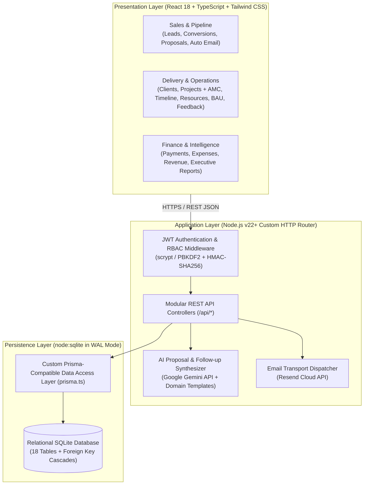
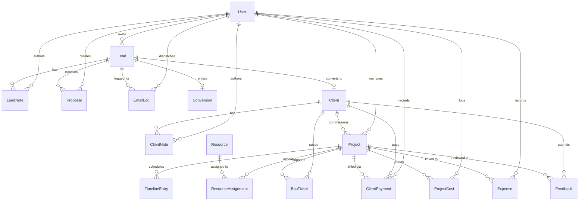

# Software Requirements Specification (SRS)
## Project Name: NexCRM — Full-Lifecycle Enterprise IT & AI Services CRM
**Document Version:** 2.0.0  
**Date:** November 11, 2026  
**Target Organization:** NexInt AI Technologies (Indian IT Services & AI Solutions)  
**Compliance Standard:** IEEE Std 830-1998 / ISO/IEC/IEEE 29148  

---

## 1. Introduction

### 1.1 Purpose
This Software Requirements Specification (SRS) provides a complete, authoritative specification of the functional, non-functional, data model, interface, and operational requirements for **NexCRM** ([`app.ts`](file:///Users/vishaalarun/PycharmProjects/NexCRM/backend/src/app.ts)). NexCRM is an integrated Customer Relationship Management (CRM), Project Delivery, Financial Accounting, and Support Operations platform purpose-built for **NexInt AI Technologies**, an Indian IT services and AI consulting enterprise.

### 1.2 Product Scope
NexCRM unifies the end-to-end commercial and delivery lifecycle across **16 core operational modules**:
1. **Executive Dashboard**: Real-time KPIs across pipeline funnel, project health, follow-up alerts, and delivery velocity.
2. **Pre-Sales & Lead Pipeline**: Lead ingestion, qualification, resource follow-up assignment (`followup_resource`), and timestamped work notes.
3. **Lead Conversion Pipeline**: Structured conversion workflow tracking win/loss outcomes, deal valuations, loss reasons, and audit history.
4. **AI Proposal Studio & Dispatch**: Domain-aware dynamic HTML proposal generation (powered by Google Gemini & built-in domain synthesizers) with 1-click email delivery.
5. **Auto Email Configuration & Follow-up Engine**: Dedicated **Resend Cloud API** transport configuration, sender branding, and automated stage-aware follow-up cadence.
6. **Client 360 & Account Management**: Master client directory linking historical lead notes, active contracts, payment phases, and support tickets.
7. **Project Delivery & AMC Tracking**: Project execution tracking with **Annual Maintenance Contract (AMC)** lifecycle management (SLA tiers, billing cycles, renewal alerts).
8. **Interactive Delivery Timeline**: Milestone, task, and deliverable scheduling with automatic or manual progress overrides.
9. **Client Milestone Payments & Invoicing**: Phased milestone billing (`ClientPayment`), payment collection tracking, and automatic invoice numbering (`INV-YYYY-XXXX`).
10. **Project Vendor Costs & Profitability**: Granular project-level expenditure tracking (`ProjectCost`) with real-time net profit and margin computation.
11. **Company Expenses Ledger**: Enterprise-wide overhead and project-linked expense tracking (`Expense`) across 10 cost categories with receipt and vendor auditing.
12. **Revenue Analytics**: Multi-horizon (Monthly/Yearly) gross contract value, vendor cost, and net profit distributions by project, service line, and lead source.
13. **Executive Reports & Analytics**: Consolidated P&L, resource conversion leaderboards, AMC recurring revenue metrics, and support ticket resolution (MTTR & SLA) intelligence.
14. **Resource & Capacity Directory**: Executive leadership (CEO, CMO, CTO) and engineering talent profiles, hourly billing rates, skill matrices, and project allocation percentages.
15. **Business-As-Usual (BAU) Support Desk**: SLA-governed post-delivery support ticketing with priority levels, state workflows, and resolution time tracking.
16. **Client CSAT & Feedback Hub + System Backup**: 1–5 star client satisfaction logging, testimonial curation, and 1-click JSON database snapshot backup/restore.

### 1.3 Definitions, Acronyms, and Abbreviations
| Acronym / Term | Definition |
| :--- | :--- |
| **AMC** | Annual Maintenance Contract (Post-delivery recurring support contract) |
| **BAU** | Business As Usual (Ongoing maintenance and support ticket operations) |
| **CSAT** | Customer Satisfaction Score (1 to 5 star rating scale) |
| **INR (`₹`)** | Indian Rupee — standardized base currency across all financial modules |
| **JWT** | JSON Web Token (Stateless authentication token format) |
| **MTTR** | Mean Time To Resolve (Average hours elapsed from ticket creation to resolution) |
| **RBAC** | Role-Based Access Control (`ADMIN` vs `MEMBER`) |
| **SLA** | Service Level Agreement (Target response and resolution window) |
| **WAL** | Write-Ahead Logging (SQLite concurrency and crash-recovery mode) |

---

## 2. Overall Description

### 2.1 System Architecture
NexCRM uses a decoupled Single-Page Application (SPA) frontend communicating over RESTful JSON endpoints with a zero-dependency Node.js v22+ HTTP server and an embedded SQLite relational engine (`node:sqlite`).

### 2.2 User Classes and Executive Accounts
The platform enforces Role-Based Access Control (RBAC) across two primary security roles (`ADMIN` and `MEMBER`) and comes pre-provisioned with executive leadership profiles in both the `User` and `Resource` directories:

| Executive Name | Role Title | Email / Login ID | System Role | Department |
| :--- | :--- | :--- | :--- | :--- |
| **Vivek Mohandass** | **CEO** | `vinuvivek1@gmail.com` | `ADMIN` | `Executive Leadership` |
| **Glanee Rose** | **CMO** | `glenysimon@gmail.com` | `ADMIN` | `Executive Leadership` |
| **Vishaal Arun** | **CTO** | `vishaal351@gmail.com` | `ADMIN` | `Executive Leadership` |
| **Team / Delivery Member** | Engineer / PM | Custom Registered Email | `MEMBER` | Engineering / AI & Data / etc. |

### 2.3 Design and Implementation Constraints
1. **Standardized Currency**: All financial inputs, proposals, milestone invoices, project budgets, AMC contracts, vendor costs, and company expenses operate in **Indian Rupees (`INR` / `₹`)**.
2. **Core Service Lines**: All leads, proposals, and projects classify into four core service lines:
   - `AI services`
   - `Data Engineering`
   - `Idea to Launch`
   - `Others`
3. **Exclusive Cloud Email Transport**: Outbound email automation is streamlined exclusively around the **Resend Cloud API** (`https://api.resend.com/emails`) with database-persisted configuration and fallback logging.
4. **Zero External Database Dependency**: Uses Node.js 22 native `node:sqlite` (`DatabaseSync`) with `PRAGMA journal_mode = WAL` and `PRAGMA foreign_keys = ON`.

---

## 3. Relational Data Model & Schema Specification

### 3.1 Entity-Relationship Diagram (18 Tables)

### 3.2 Table Schema Definitions ([`prisma.ts`](file:///Users/vishaalarun/PycharmProjects/NexCRM/backend/src/lib/prisma.ts))

| # | Table Name | Primary Key | Key Columns & Relationships |
| :--- | :--- | :--- | :--- |
| 1 | **`User`** | `id` (UUID) | `name`, `email` (UNIQUE), `password_hash` (scrypt/PBKDF2), `role` (`ADMIN`\|`MEMBER`), `created_at` |
| 2 | **`Lead`** | `id` (UUID) | `name`, `company`, `email`, `phone`, `source`, `service`, `budget`, `currency`, `status`, `owner_id` (FK), `next_followup`, `followup_resource`, `notes`, `created_at` |
| 3 | **`LeadNote`** | `id` (UUID) | `lead_id` (FK CASCADE), `text`, `created_by` (FK), `created_at` |
| 4 | **`Conversion`** | `id` (UUID) | `lead_id` (UNIQUE FK), `outcome` (`in_progress`\|`converted`\|`not_converted`), `reason`, `comment`, `deal_value`, `currency`, `decided_at`, `history` (JSON), `created_at` |
| 5 | **`Client`** | `id` (UUID) | `lead_id` (UNIQUE FK), `company`, `contact_name`, `email`, `phone`, `address`, `website`, `industry`, `status` (`Active`\|`Inactive`\|`Prospect`), `notes`, `became_client_at`, `created_at` |
| 6 | **`ClientNote`** | `id` (UUID) | `client_id` (FK CASCADE), `text`, `created_by` (FK), `created_at` |
| 7 | **`Project`** | `id` (UUID) | `client_id` (FK), `name`, `description`, `service_type`, `status`, `start_date`, `end_date`, `budget`, `currency`, `manager_id` (FK), `tech_stack`, `progress`, `progress_override`, `notes`, `amc_active`, `amc_status`, `amc_amount`, `amc_start_date`, `amc_end_date`, `amc_renewal_date`, `amc_billing_cycle`, `amc_sla_tier`, `amc_hours_included`, `amc_hours_used`, `amc_scope`, `amc_notes`, `amc_contact`, `created_at` |
| 8 | **`TimelineEntry`** | `id` (UUID) | `project_id` (FK CASCADE), `title`, `description`, `type` (`Milestone`\|`Task`\|`Deliverable`), `start_date`, `end_date`, `status`, `assignee_id` (FK), `sort_order`, `created_at` |
| 9 | **`ProjectCost`** | `id` (UUID) | `project_id` (FK CASCADE), `title`, `category`, `vendor_or_resource`, `amount`, `incurred_date`, `notes`, `created_by` (FK), `created_at` |
| 10 | **`ClientPayment`** | `id` (UUID) | `client_id` (FK), `project_id` (FK), `phase_name`, `phase_number`, `amount`, `currency`, `percentage`, `status` (`Pending`\|`Partial`\|`Paid`\|`Overdue`), `due_date`, `paid_date`, `paid_amount`, `invoice_number`, `payment_method`, `transaction_ref`, `notes`, `created_by` (FK), `created_at` |
| 11 | **`Expense`** | `id` (UUID) | `title`, `category`, `amount`, `currency`, `expense_date`, `status` (`Paid`\|`Pending`\|`Reimbursed`\|`Cancelled`), `payment_method`, `vendor`, `invoice_number`, `receipt_url`, `project_id` (FK NULLABLE), `paid_by`, `recurring`, `recurring_cycle`, `notes`, `created_by` (FK), `created_at` |
| 12 | **`Resource`** | `id` (UUID) | `name`, `email` (UNIQUE), `role_title`, `department` (`Executive Leadership`\|`Engineering`\|`Cloud & DevOps`\|`AI & Data`\|`Design & UX`\|`Delivery & QA`), `seniority` (`Executive`\|`Principal`\|`Senior`\|`Mid-Level`\|`Junior`), `skills`, `total_capacity`, `hourly_rate`, `on_leave`, `notes`, `created_at` |
| 13 | **`ResourceAssignment`** | `id` (UUID) | `resource_id` (FK CASCADE), `project_id` (FK CASCADE), `assignment_role`, `allocation_pct`, `start_date`, `end_date`, `status` (`Active`\|`Planned`\|`Completed`), `notes`, `created_at` |
| 14 | **`Proposal`** | `id` (UUID) | `proposal_number` (UNIQUE), `lead_id` (FK), `client_id` (FK), `company_name`, `recipient_name`, `recipient_email`, `project_title`, `service_type`, `budget`, `currency`, `timeline_weeks`, `key_requirements`, `email_subject`, `email_body`, `html_proposal`, `ai_model`, `status` (`Draft`\|`Sent`\|`Accepted`\|`Declined`), `sent_at`, `created_by` (FK), `created_at` |
| 15 | **`BauTicket`** | `id` (UUID) | `ticket_number` (UNIQUE), `client_id` (FK), `project_id` (FK), `title`, `description`, `category`, `priority` (`Critical`\|`High`\|`Medium`\|`Low`), `state` (`New`\|`In progress`\|`Waiting on client`\|`Resolved`\|`Closed`), `reported_by`, `assignee_id` (FK), `resolution_notes`, `sla_due_date`, `resolved_at`, `created_at` |
| 16 | **`Feedback`** | `id` (UUID) | `client_id` (FK), `project_id` (FK), `rating` (1–5), `sentiment` (`Positive`\|`Neutral`\|`Negative`), `category`, `comment`, `action_taken`, `status`, `submitted_by`, `feedback_date`, `recorded_by` (FK), `is_testimonial`, `created_at` |
| 17 | **`EmailLog`** | `id` (UUID) | `lead_id` (FK), `client_id`, `recipient_email`, `recipient_name`, `subject`, `body`, `status` (`Sent`\|`Simulated`\|`Failed`), `provider`, `error_message`, `sent_by` (FK), `sent_at` |
| 18 | **`SystemSetting`** | `key` (TEXT) | `value` (JSON/TEXT), `updated_at` (Stores `email_automation_config`) |

---

## 4. Detailed Functional Requirements

### 4.1 Module 1: Authentication, Security & Quick-Access Login
- **FR-AUTH-01**: Support email and password login via `POST /api/auth/login` verifying credentials against `scrypt` and `PBKDF2-SHA256` password hashes ([`auth.ts`](file:///Users/vishaalarun/PycharmProjects/NexCRM/backend/src/routes/auth.ts)).
- **FR-AUTH-02**: Issue signed 7-day JWT bearer tokens containing `id`, `name`, `email`, and `role`.
- **FR-AUTH-03**: Provide 1-click executive quick-fill login chips on [`LoginPage.tsx`](file:///Users/vishaalarun/PycharmProjects/NexCRM/frontend/src/pages/LoginPage.tsx) for **Vivek Mohandass**, **Glanee Rose**, and **Vishaal Arun**.

### 4.2 Module 2: Lead Pipeline & Follow-Up Work Notes
- **FR-LEAD-01**: Manage leads across lifecycle statuses: `New`, `Contacted`, `Qualified`, `Proposal sent`, `Negotiation`, `Converted`, and `Not converted` ([`LeadsPage.tsx`](file:///Users/vishaalarun/PycharmProjects/NexCRM/frontend/src/pages/LeadsPage.tsx)).
- **FR-LEAD-02**: Assign a dedicated `followup_resource` and `next_followup` date to each lead to track pre-sales ownership until conversion.
- **FR-LEAD-03**: Maintain an chronological thread of `LeadNote` entries recording the author's name, role, and timestamp, with support for simultaneous lead status and follow-up date updates when logging a note.
- **FR-LEAD-04**: Support CSV bulk import/export and 1-click pipeline movement to the Conversion board (`POST /api/leads/:id/move-to-conversion`).

### 4.3 Module 3: Conversion Pipeline & Automatic Client Promotion
- **FR-CONV-01**: Track leads in the conversion pipeline across three states: `in_progress`, `converted`, and `not_converted` ([`LeadConversionPage.tsx`](file:///Users/vishaalarun/PycharmProjects/NexCRM/frontend/src/pages/LeadConversionPage.tsx)).
- **FR-CONV-02**: Require a `deal_value` (`>= 0`) when marking a conversion as `converted`, and require a structured `reason` (`Budget`, `Went to competitor`, `No response`, `Timing`, `Requirements mismatch`, `Other`) when marking as `not_converted`.
- **FR-CONV-03**: Automatically create and link a `Client` record upon conversion (if one does not already exist) and append an immutable audit entry to the conversion's `history` JSON array.

### 4.4 Module 4: Dynamic AI Proposal Studio
- **FR-PROP-01**: Synthesize bespoke, domain-specific HTML proposals (`POST /api/proposals/generate`) tailored to the client's industry (Healthcare, FinTech, Data Lakehouse, E-Commerce, AI Agents, etc.) and custom prompt requirements ([`proposals.ts`](file:///Users/vishaalarun/PycharmProjects/NexCRM/backend/src/routes/proposals.ts)).
- **FR-PROP-02**: Generate structured deliverables, system architecture blueprints, phase-wise timelines, and investment breakdowns in `INR (₹)`.
- **FR-PROP-03**: Dispatch proposals via email (`POST /api/proposals/:id/send`), automatically transitioning the proposal status to `Sent` and the linked lead status to `Proposal sent`.

### 4.5 Module 5: Auto Email Configuration & Follow-Up Automation
- **FR-MAIL-01**: Provide a dedicated **Auto Email Configuration** tab ([`AutoEmailPage.tsx`](file:///Users/vishaalarun/PycharmProjects/NexCRM/frontend/src/pages/AutoEmailPage.tsx)) configured exclusively for the **Resend Cloud API** (`provider: 'resend'`).
- **FR-MAIL-02**: Allow administrators to configure `resend_api_key`, `sender_name`, `sender_email`, `reply_to_email`, `auto_followup_enabled`, `followup_interval_days`, `max_followup_attempts`, and `include_proposal_link` via `PUT /api/automation/config`.
- **FR-MAIL-03**: Provide a live **Test Email Delivery** tool (`POST /api/automation/test-email`) and a **Batch Follow-Up Runner** (`POST /api/automation/run-batch`) that identifies overdue leads, generates context-aware follow-up emails, sends them via Resend, and logs every transmission in `EmailLog`.

### 4.6 Module 6: Project Delivery & Annual Maintenance Contract (AMC) Tracking
- **FR-PROJ-01**: Manage client delivery projects across `Planned`, `In progress`, `On hold`, `Completed`, and `Cancelled` statuses ([`ProjectsPage.tsx`](file:///Users/vishaalarun/PycharmProjects/NexCRM/frontend/src/pages/ProjectsPage.tsx)).
- **FR-PROJ-02**: Track **Annual Maintenance Contracts (AMC)** directly on delivered or active projects (`PUT /api/projects/:id`), including:
  - `amc_active` (boolean toggle)
  - `amc_status` (`Active`, `Pending Renewal`, `Expired`, `Not Contracted`)
  - `amc_amount` (recurring fee in `INR`)
  - `amc_billing_cycle` (`Annual`, `Quarterly`, `Monthly`)
  - `amc_sla_tier` (`Standard 9x5`, `Priority 12x6`, `Mission Critical 24x7`, `Dedicated Engineer`)
  - `amc_start_date`, `amc_renewal_date`, `amc_hours_included`, `amc_hours_used`, and `amc_notes`.
- **FR-PROJ-03**: Surface automated renewal alerts for AMCs expiring within 30 days.

### 4.7 Module 7: Client Milestone Payments & Invoicing
- **FR-PAY-01**: Track phased project billing (`ClientPayment`) with milestone percentages, due dates, paid amounts, payment methods (`Bank Transfer / NEFT`, `UPI`, `Razorpay / Stripe`, `Cheque`, `Wire Transfer`), and transaction references ([`ClientPaymentsPage.tsx`](file:///Users/vishaalarun/PycharmProjects/NexCRM/frontend/src/pages/ClientPaymentsPage.tsx)).
- **FR-PAY-02**: Automatically generate sequential invoice numbers (`INV-YYYY-XXXX`) when a payment phase is marked as `Paid` (`PUT /api/payments/:id`).

### 4.8 Module 8: Project Vendor Costs & Company Expenses Ledger
- **FR-EXP-01**: Track project-specific direct delivery costs (`ProjectCost`) to compute real-time project net margin:
  $$\text{Project Net Profit} = \text{Project Budget} - \sum \text{ProjectCost.amount}$$
- **FR-EXP-02**: Provide a dedicated **Expenses** tab ([`ExpensesPage.tsx`](file:///Users/vishaalarun/PycharmProjects/NexCRM/frontend/src/pages/ExpensesPage.tsx)) to manage company-wide and project-linked expenses (`Expense`) across categories:
  - `Cloud & Hosting`, `Software & SaaS Licenses`, `AI APIs & LLM Tokens`, `Contractor & Freelancer`, `Payroll & Salaries`, `Office & Infrastructure`, `Marketing & Ads`, `Travel & Client Meetings`, `Hardware & Equipment`, `Legal & Accounting`, and `Miscellaneous`.
- **FR-EXP-03**: Support full CRUD operations, status toggles (`Paid`, `Pending`, `Reimbursed`, `Cancelled`), recurring expense cycles, and CSV export (`GET /api/expenses`, `POST /api/expenses`, `PUT /api/expenses/:id`, `DELETE /api/expenses/:id`).

### 4.9 Module 9: Executive Reports & Analytics Suite
- **FR-REP-01**: Provide a comprehensive **Reports** tab ([`ReportsPage.tsx`](file:///Users/vishaalarun/PycharmProjects/NexCRM/frontend/src/pages/ReportsPage.tsx), `GET /api/reports/comprehensive`) with date-range filtering (`All Time`, `This Month`, `Last 3 Months`, `Last 6 Months`, `This Year`, `Custom Range`).
- **FR-REP-02**: Compute consolidated enterprise financial metrics:
  $$\text{Total Income Received} = \sum_{\text{status}=\text{Paid}} \text{ClientPayment.paid\_amount}$$
  $$\text{Total Outflow} = \sum_{\text{status}=\text{Paid}} \text{Expense.amount} + \sum \text{ProjectCost.amount}$$
  $$\text{Net Profit} = \text{Total Income Received} - \text{Total Outflow}$$
- **FR-REP-03**: Generate the **Resource Conversion Leaderboard**, ranking team members and resources by total leads handled, converted leads count, conversion rate (`%`), and total deal value won (`₹`).
- **FR-REP-04**: Compute **Support Ticket & Resolution Speed (MTTR) Analytics** from `BauTicket`:
  - Total tickets received vs. resolved vs. open backlog.
  - SLA Compliance Rate (`%` of tickets resolved on or before `sla_due_date`).
  - Average, Fastest, and Slowest resolution times (in hours and days) calculated from `created_at` to `resolved_at`.
  - Breakdown by Priority (`Critical`, `High`, `Medium`, `Low`) and Category.

### 4.10 Module 10: Resource & Executive Directory
- **FR-RES-01**: Maintain resource profiles across departments (`Executive Leadership`, `Engineering`, `Cloud & DevOps`, `AI & Data`, `Design & UX`, `Delivery & QA`) and seniorities (`Executive`, `Principal`, `Senior`, `Mid-Level`, `Junior`) ([`ResourcesPage.tsx`](file:///Users/vishaalarun/PycharmProjects/NexCRM/frontend/src/pages/ResourcesPage.tsx)).
- **FR-RES-02**: Compute live capacity utilization (`allocated_pct`, `available_pct`) from active `ResourceAssignment` records and classify availability (`Available`, `Partially Allocated`, `Fully Allocated`, `Overallocated`, `On Leave`).

### 4.11 Module 11: BAU Support Desk, CSAT Feedback & System Backup
- **FR-BAU-01**: Track post-delivery `BauTicket` items with automatic `resolved_at` timestamping when transitioning to `Resolved` or `Closed` ([`BauPage.tsx`](file:///Users/vishaalarun/PycharmProjects/NexCRM/frontend/src/pages/BauPage.tsx)).
- **FR-CSAT-01**: Capture client ratings (1–5 stars), sentiment classification, and testimonial flags ([`FeedbackPage.tsx`](file:///Users/vishaalarun/PycharmProjects/NexCRM/frontend/src/pages/FeedbackPage.tsx)).
- **FR-SYS-01**: Provide full database JSON snapshot export (`GET /api/system/backup`) and point-in-time transactional restore (`POST /api/system/restore`) ([`system.ts`](file:///Users/vishaalarun/PycharmProjects/NexCRM/backend/src/routes/system.ts)).

---

## 5. Non-Functional Requirements

### 5.1 Performance & Scalability
- **NFR-PERF-01**: Read API endpoints (`/api/dashboard`, `/api/reports/comprehensive`, `/api/leads`) shall respond within `< 150ms` for datasets up to 10,000 records using indexed SQLite queries in `WAL` mode.
- **NFR-PERF-02**: Frontend production bundle built via Vite 5 + TypeScript 5 (`npm run build --prefix frontend`) shall render interactive views with zero page reloads.

### 5.2 Security & Data Integrity
- **NFR-SEC-01**: Password hashes (`password_hash`) and raw secret keys shall never be exposed in unauthenticated responses; Resend API keys are masked in GET responses (`re_••••`).
- **NFR-SEC-02**: All SQL queries execute via prepared statements (`db.prepare(...)`) to prevent SQL injection.
- **NFR-SEC-03**: Foreign key constraints (`PRAGMA foreign_keys = ON`) enforce referential integrity across all 18 tables.

### 5.3 Usability & Visual Design
- **NFR-UI-01**: Adhere to NexInt AI corporate branding (Primary Navy `#0F2547`, Accent Cyan `#3596B0`) with full Light and Dark mode support.
- **NFR-UI-02**: Provide 1-click CSV export across Leads, Clients, Projects, Payments, Expenses, Resources, and Executive Reports.

---

## 6. Complete API Endpoint Reference

| Module | Method | Endpoint | Description |
| :--- | :--- | :--- | :--- |
| **Health** | `GET` | `/api/health` | Service liveness & timestamp check |
| **Auth** | `POST` | `/api/auth/login` | Authenticate user & issue JWT token |
| **Auth** | `POST` | `/api/auth/register` | Register new user account |
| **Auth** | `GET` | `/api/auth/me` | Retrieve current authenticated user profile |
| **Auth** | `GET` | `/api/auth/users` | List all system users for owner/manager assignment |
| **Dashboard** | `GET` | `/api/dashboard` | Aggregated executive KPIs, funnel, and alerts |
| **Leads** | `GET / POST` | `/api/leads` | List/filter leads or create a new lead |
| **Leads** | `PUT / DELETE` | `/api/leads/:id` | Update lead attributes or delete lead |
| **Leads** | `POST` | `/api/leads/:id/notes` | Append work note & optionally update status/follow-up |
| **Leads** | `POST` | `/api/leads/:id/move-to-conversion` | Promote lead into the Conversion pipeline |
| **Conversions** | `GET / PUT` | `/api/conversions`, `/api/conversions/:id` | List conversions or update outcome (`converted`/`not_converted`) |
| **Clients** | `GET / POST / PUT / DELETE` | `/api/clients`, `/api/clients/:id` | Full Client 360 CRUD & client notes |
| **Projects** | `GET / POST / PUT / DELETE` | `/api/projects`, `/api/projects/:id` | Project delivery CRUD + AMC contract management |
| **Projects** | `POST / DELETE` | `/api/projects/:id/costs` | Log or remove project vendor/resource costs |
| **Timeline** | `GET / POST / PUT / DELETE` | `/api/timeline` | Manage project milestones, tasks, and deliverables |
| **Proposals** | `POST` | `/api/proposals/generate` | Synthesize dynamic AI HTML proposal |
| **Proposals** | `POST` | `/api/proposals/:id/send` | Dispatch proposal email via Resend & update lead |
| **Automation** | `GET / PUT` | `/api/automation/config` | Read or update Resend Cloud API & follow-up settings |
| **Automation** | `POST` | `/api/automation/test-email` | Dispatch live test email via Resend Cloud API |
| **Automation** | `POST` | `/api/automation/run-batch` | Execute automated follow-up batch for due leads |
| **Payments** | `GET / POST / PUT / DELETE` | `/api/payments`, `/api/payments/:id` | Manage client milestone payment phases & invoices |
| **Expenses** | `GET / POST / PUT / DELETE` | `/api/expenses`, `/api/expenses/:id` | Manage company overhead & project-linked expenses |
| **Revenue** | `GET` | `/api/revenue` | Monthly/Yearly revenue, vendor cost, and margin analytics |
| **Reports** | `GET` | `/api/reports/comprehensive` | Consolidated P&L, resource conversions, AMC & ticket SLA metrics |
| **Resources** | `GET / POST / PUT / DELETE` | `/api/resources`, `/api/resources/:id` | Manage executive & technical resources and assignments |
| **BAU Desk** | `GET / POST / PUT / DELETE` | `/api/bau-tickets`, `/api/bau-tickets/:id` | Manage post-delivery SLA support tickets |
| **Feedback** | `GET / POST / PUT / DELETE` | `/api/feedback`, `/api/feedback/:id` | Manage client CSAT ratings & public testimonials |
| **System** | `GET / POST` | `/api/system/backup`, `/api/system/restore` | Full JSON database snapshot export & restore |

---

## 7. Automated Verification & Test Suite Matrix

NexCRM includes **35 automated integration tests** across **8 test suites** (`npm test --prefix backend`):

| Suite File | Focus Area | Verified Scenarios |
| :--- | :--- | :--- |
| [`automation.test.ts`](file:///Users/vishaalarun/PycharmProjects/NexCRM/backend/src/__tests__/automation.test.ts) | Auto Email & Follow-up Engine | Stage-aware draft synthesis, Resend dispatch logging, batch runner execution |
| [`conversion.test.ts`](file:///Users/vishaalarun/PycharmProjects/NexCRM/backend/src/__tests__/conversion.test.ts) | Lead → Conversion → Client | Pipeline transition, mandatory loss reason validation, auto-client creation & audit trail |
| [`dynamic_proposal.test.ts`](file:///Users/vishaalarun/PycharmProjects/NexCRM/backend/src/__tests__/dynamic_proposal.test.ts) | AI Proposal Synthesis | Healthcare, Data Lakehouse, E-Commerce domain synthesis & clean NexInt branding |
| [`expenses.test.ts`](file:///Users/vishaalarun/PycharmProjects/NexCRM/backend/src/__tests__/expenses.test.ts) | Company Expenses Ledger | Overhead & project-linked creation, status transitions, aggregation, partial edit validation |
| [`lead_worknotes.test.ts`](file:///Users/vishaalarun/PycharmProjects/NexCRM/backend/src/__tests__/lead_worknotes.test.ts) | Lead Work Notes & Ownership | Author attribution, `followup_resource` persistence through conversion |
| [`payments.test.ts`](file:///Users/vishaalarun/PycharmProjects/NexCRM/backend/src/__tests__/payments.test.ts) | Client Milestone Payments | Phase creation, milestone progress updates, hydration, auto-invoice generation |
| [`reports.test.ts`](file:///Users/vishaalarun/PycharmProjects/NexCRM/backend/src/__tests__/reports.test.ts) | Executive Reports & SLA | Income/expense/margin P&L, resource conversion leaderboard, AMC metrics, support MTTR |
| [`system_backup.test.ts`](file:///Users/vishaalarun/PycharmProjects/NexCRM/backend/src/__tests__/system_backup.test.ts) | Backup & Restore | Full database snapshot export and relational state restoration |
