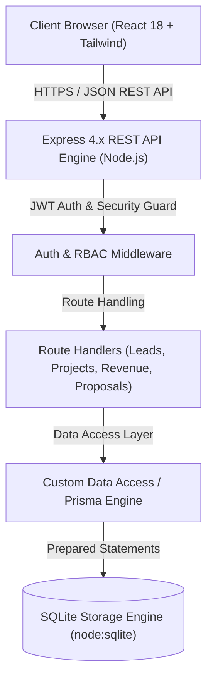
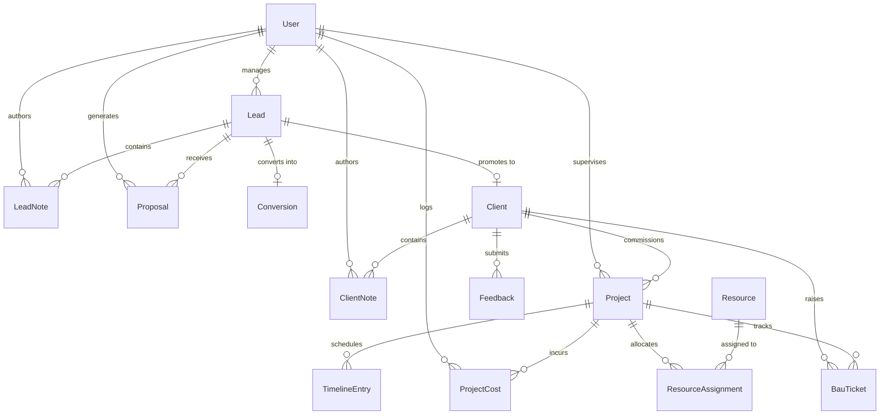

# Software Requirements Specification (SRS)
## Project Name: NexCRM — Enterprise IT & AI Services CRM
**Document Version:** 1.0.0  
**Date:** November 2026  
**Target Organization:** NexInt AI / NexCRM (Indian IT Services & AI Solutions)  
**Standard:** IEEE 830-1998 Compliant  

---

## 1. Introduction

### 1.1 Purpose
This Software Requirements Specification (SRS) document details the complete functional, non-functional, interface, and architectural requirements for **NexCRM**. NexCRM is a full-lifecycle Customer Relationship Management and Delivery Operations platform tailored specifically for an Indian Information Technology enterprise specializing in Artificial Intelligence, Data Engineering, and digital product incubation.

### 1.2 Scope of the Software
NexCRM unifies the end-to-end IT services delivery lifecycle:
1. **Pre-Sales & Lead Pipeline**: Ingestion, qualification, and stage progression of prospective client leads.
2. **AI-Driven Proposal Automation**: Contextual proposal generation and client dispatch with automated status transitions.
3. **Client 360 & Account Management**: Centralized client master records linked directly to lead conversion history.
4. **Project & Delivery Tracking**: Milestone and task execution tracking with interactive timelines.
5. **Vendor Cost & Profitability Accounting**: Granular project-level cost tracking (AWS cloud infrastructure, contractor/freelancer, resource allocation) with automated net profit margin calculation in Indian Rupees (INR, ₹).
6. **Executive Revenue Analytics**: Multi-dimensional monthly and yearly revenue analysis aggregated across projects and acquisition sources.
7. **Resource & Capacity Management**: Technical resource allocation, seniority tracking, and utilization percentages.
8. **Business-As-Usual (BAU) & Support Operations**: SLA-governed support ticketing and client CSAT/testimonial logging.

### 1.3 Definitions, Acronyms, and Abbreviations
- **CRM**: Customer Relationship Management
- **SRS**: Software Requirements Specification
- **INR (₹)**: Indian Rupee (Default base currency)
- **BAU**: Business As Usual (Maintenance & Ongoing Support)
- **RBAC**: Role-Based Access Control
- **CSAT**: Customer Satisfaction Score
- **SLA**: Service Level Agreement
- **JWT**: JSON Web Token
- **REST**: Representational State Transfer

### 1.4 References
- IEEE Std 830-1998: IEEE Recommended Practice for Software Requirements Specifications.
- NexCRM Architecture & Implementation Repository.

---

## 2. Overall Description

### 2.1 Product Perspective
NexCRM operates as a modern client-server web application. It delivers a high-speed single-page application (SPA) front-end paired with a modular REST API backend and an embedded, high-performance relational database engine.

### 2.2 User Classes and Characteristics
| User Class | Description | Privileges |
| :--- | :--- | :--- |
| **System Administrator (ADMIN)** | Executive management, finance heads, and practice leads. | Full read/write/delete privileges across all leads, clients, financials, proposals, users, and system metrics. |
| **Team Member / Delivery Manager (MEMBER)** | Project managers, business development associates, and technical leads. | Lead management, proposal generation, project milestone updates, cost logging, and support ticket resolution. |

### 2.3 Operating Environment
- **Server Platform**: Node.js v22+ (Native type stripping and `node:sqlite` acceleration)
- **Client Platform**: Modern Web Browsers (Chrome, Safari, Firefox, Edge) supporting ECMAScript 2022+
- **Host OS**: macOS / Linux / Windows Server / Containerized environments

### 2.4 Design and Implementation Constraints
1. **Base Currency Standardization**: All financial calculations, quotes, proposals, vendor expenditures, and revenue reports must strictly compute and display in **Indian Rupees (INR / ₹)**.
2. **Dedicated Core Services**: Service classifications across the platform must adhere strictly to the 4 offerings:
   - `AI services`
   - `Data Engineering`
   - `Idea to Launch`
   - `Others`
3. **Database Portability**: Zero external database server overhead by leveraging high-performance, ACID-compliant relational SQLite storage.

---

## 3. System Architecture & Data Model

### 3.1 Entity Relationship Diagram

### 3.2 Schema Specifications
- **User**: `id`, `name`, `email`, `password_hash`, `role` (`ADMIN` | `MEMBER`), `created_at`.
- **Lead**: `id`, `name`, `company`, `email`, `phone`, `source`, `service`, `budget`, `currency`, `status`, `owner_id`, `next_followup`, `notes`, `created_at`.
- **Conversion**: `id`, `lead_id`, `outcome`, `reason`, `comment`, `deal_value`, `currency`, `decided_at`, `history`, `created_at`.
- **Client**: `id`, `lead_id`, `company`, `contact_name`, `email`, `phone`, `address`, `website`, `industry`, `status`, `notes`, `became_client_at`, `created_at`.
- **Project**: `id`, `client_id`, `name`, `description`, `service_type`, `status`, `start_date`, `end_date`, `budget`, `currency`, `manager_id`, `tech_stack`, `progress`, `progress_override`, `notes`, `created_at`.
- **ProjectCost**: `id`, `project_id`, `title`, `category`, `vendor_or_resource`, `amount`, `incurred_date`, `notes`, `created_by`, `created_at`.
- **Proposal**: `id`, `proposal_number`, `lead_id`, `client_id`, `company_name`, `recipient_name`, `recipient_email`, `project_title`, `service_type`, `budget`, `currency`, `timeline_weeks`, `key_requirements`, `email_subject`, `email_body`, `html_proposal`, `ai_model`, `status`, `sent_at`, `created_by`, `created_at`.

---

## 4. Functional Requirements

### 4.1 Module 1: Authentication & Access Control
- **FR-AUTH-101**: The system shall provide secure JWT authentication using PBKDF2/SHA-256 salted password hashing.
- **FR-AUTH-102**: The system shall support Role-Based Access Control distinguishing `ADMIN` and `MEMBER`.
- **FR-AUTH-103**: The API shall validate bearer tokens on all protected `/api/*` endpoints and reject unauthenticated requests with HTTP 401.

### 4.2 Module 2: Lead Pipeline Management
- **FR-LEAD-201**: The system shall support CRUD operations on leads with the following pipeline stages:
  - `New`, `Contacted`, `Qualified`, `Proposal sent`, `Negotiation`, `Won`, `Lost`.
- **FR-LEAD-202**: Available service offerings for any lead must be restricted to:
  - `AI services`
  - `Data Engineering`
  - `Idea to Launch`
  - `Others`
- **FR-LEAD-203**: When a lead is marked as `Won`, the system shall enable 1-click conversion to an active `Client` and seed their project account.
- **FR-LEAD-204**: The system shall record timestamps, notes, and owner changes on the lead audit thread.

### 4.3 Module 3: AI Proposal Generation & Dispatch
- **FR-PROP-301**: The system shall provide a generation studio that accepts requirements, project scope, timeline, and budget parameters.
- **FR-PROP-302**: Generated proposals shall output cleanly formatted HTML styled with professional typography, scope tables, tech stack details, and milestone matrices.
- **FR-PROP-303**: Proposals must not contain external vendor watermarks ("Powered by Argon AI") and must represent NexCRM / NexInt AI enterprise branding.
- **FR-PROP-304**: When a proposal is dispatched to a prospective client:
  - The proposal status shall be updated to `Sent` with `sent_at` timestamp.
  - The associated lead's status shall automatically transition to `Proposal sent`.

### 4.4 Module 4: Project Delivery & Timeline Tracking
- **FR-PROJ-401**: Projects must track `client_id`, `service_type`, `status` (`Planned`, `In progress`, `On hold`, `Completed`, `Cancelled`), `budget` (INR), and `manager_id`.
- **FR-PROJ-402**: The project timeline shall visualize tasks, milestones, deliverables, and assignees.
- **FR-PROJ-403**: Progress shall be calculable automatically based on milestone completion percentage, or via explicit manager override.

### 4.5 Module 5: Vendor Cost & Profitability Accounting
- **FR-COST-501**: Within any project, authorized users must be able to record expenses categorized into:
  - `Cloud / Infrastructure` (e.g. AWS hosting, staging environments, GPUs)
  - `Resource Allocation` (e.g. dedicated engineering squads, UI/UX designers)
  - `Third-Party Vendor / API` (e.g. OpenAI / Anthropic API consumption)
  - `Software License / SaaS`
  - `Contractor / Freelancer`
  - `Other`
- **FR-COST-502**: The financial computation engine must dynamically evaluate:
  $$\text{Total Incurred Cost} = \sum (\text{Project Cost Amounts})$$
  $$\text{Net Profit} = \text{Budget} - \text{Total Incurred Cost}$$
  $$\text{Profit Margin (\%)} = \left(\frac{\text{Net Profit}}{\text{Budget}}\right) \times 100$$
- **FR-COST-503**: Project views must display budget depletion warnings if incurred costs approach or exceed 100% of the allocated budget.

### 4.6 Module 6: Executive Revenue Analytics Dashboard
- **FR-REV-601**: The system shall aggregate revenue metrics across both **Monthly** and **Yearly** horizons.
- **FR-REV-602**: The revenue engine shall aggregate project contract values, costs, and profits grouped by:
  - Delivery Project
  - Customer Acquisition Source (e.g., Referral, Inbound, LinkedIn, Website)
  - Service Offering Category
- **FR-REV-603**: Financial dashboards shall render graphical distributions comparing gross contract value, incurred vendor expenditure, and net retained margins.

### 4.7 Module 7: Resource & Talent Management
- **FR-RES-701**: The system shall maintain internal technical talent profiles including skills, seniority level, department, hourly rate in INR, and availability.
- **FR-RES-702**: Project allocation percentages must be tracked across assignments to prevent over-allocation (>100% capacity).

### 4.8 Module 8: Support Ticketing (BAU) & Quality Feedback
- **FR-SUP-801**: Support tickets shall track SLA due dates, severity, client association, and assignment state (`New`, `In progress`, `Waiting on client`, `Resolved`, `Closed`).
- **FR-SUP-802**: Client CSAT records shall capture 1-5 star ratings, sentiment categorization, feedback comments, and a toggle for public marketing testimonials.

---

## 5. Non-Functional Requirements

### 5.1 Performance Requirements
- **NFR-PERF-1**: API response times for read operations shall be less than 150ms under typical loads (1,000 concurrent entities).
- **NFR-PERF-2**: Initial client bundle load time must be under 1.5 seconds on standard broadband connections.
- **NFR-PERF-3**: Database transactions must be executed using SQLite write-ahead logging (WAL) and synchronous memory optimization to ensure sub-10ms write operations.

### 5.2 Security Requirements
- **NFR-SEC-1**: Sensitive fields (e.g., `password_hash`) must never be returned in API response bodies.
- **NFR-SEC-2**: All database queries must execute via parameterized SQL statements to eliminate SQL injection vectors.
- **NFR-SEC-3**: All cross-site scripting (XSS) risks in user-generated rich text and proposal HTML must be mitigated through strict DOM sanitization.

### 5.3 Reliability and Availability
- **NFR-REL-1**: Relational data integrity must be strictly enforced via Foreign Key constraints with configured cascade rules.
- **NFR-REL-2**: System state shall be resilient to sudden termination without corrupting database transactions.

### 5.4 Usability & UI Standards
- **NFR-UI-1**: The interface must adhere to the NexInt Brand Identity:
  - Primary Brand Navy: `#0F2547`
  - Accent Cyan-Teal: `#3596B0`
- **NFR-UI-2**: The application must support comprehensive Light and Dark theme modes with instantaneous user switching.
- **NFR-UI-3**: Responsive layout must support desktop displays, tablets, and mobile browser viewports.

---

## 6. Verification and Acceptance Criteria

| ID | Test Scenario | Acceptance Criteria |
| :--- | :--- | :--- |
| **AC-01** | Lead creation with Indian IT service offering | Lead is saved with currency `INR (₹)` and service matching one of the 4 valid types. |
| **AC-02** | AI Proposal Generation & Send | Dispatched proposal updates lead status to `Proposal sent` and timestamps proposal as `Sent`. |
| **AC-03** | Project Vendor Cost Deduction | Adding an AWS cost of ₹50,000 to a ₹500,000 project updates project profit to ₹450,000 (90% margin). |
| **AC-04** | Revenue Tab Aggregation | Aggregates all converted/project deal values grouped by month, year, project, and acquisition source. |
| **AC-05** | Database Clean State Verification | Seed scripts and reset operations cleanly flush business entities while keeping administrative credentials intact. |

---

## 7. Appendix: API Route Reference

| Method | Endpoint | Description | Auth Required |
| :--- | :--- | :--- | :--- |
| `POST` | `/api/auth/login` | Authenticate user & return JWT token | No |
| `POST` | `/api/auth/register` | Register new user account | No |
| `GET` | `/api/auth/me` | Fetch authenticated user profile | Yes |
| `GET` | `/api/leads` | List and filter sales leads | Yes |
| `POST` | `/api/leads` | Create a new lead | Yes |
| `POST` | `/api/leads/:id/convert` | Convert lead to client | Yes |
| `GET` | `/api/proposals` | List all AI proposals | Yes |
| `POST` | `/api/proposals/generate` | Generate AI proposal HTML | Yes |
| `POST` | `/api/proposals/:id/send` | Dispatch proposal & update lead status | Yes |
| `GET` | `/api/projects` | List projects with enriched financials | Yes |
| `POST` | `/api/projects` | Create a new delivery project | Yes |
| `POST` | `/api/projects/:id/costs` | Log vendor or resource cost | Yes |
| `GET` | `/api/revenue/summary` | Fetch monthly, yearly, and grouped revenue | Yes |
| `GET` | `/api/clients` | List clients and 360 view | Yes |
| `GET` | `/api/resources` | List staff and allocation metrics | Yes |
| `GET` | `/api/bau` | Fetch support tickets and SLA states | Yes |
| `GET` | `/api/feedback` | Fetch CSAT ratings and testimonials | Yes |

