# End-to-End Testing & QA Verification Report — NexCRM
**Document Version:** 2.0.0  
**Execution Date:** November 11, 2026  
**Status:** **44 / 44 Automated Tests Passing (100% Pass Rate)** • **0 Frontend Build Errors**  

---

## 1. Executive Summary

A full end-to-end (E2E) quality assurance and integration audit was conducted across the **NexCRM** backend API, SQLite persistence layer (`node:sqlite`), AI Proposal synthesis engine (with the 12-Question Deep Discovery Questionnaire), and React 18 + TypeScript frontend bundle.

```mermaid
flowchart LR
    A["1. Executive Auth\n(Vivek, Glanee, Vishaal)"] --> B["2. Lead + Work Notes\n& Resource Assignment"]
    B --> C["3. 12-Question Deep\nAI HTML Proposal"]
    C --> D["4. Conversion Win\n& Auto Client 360"]
    D --> E["5. Project + AMC\n+ Timeline + Costs"]
    E --> F["6. Milestone Invoices\n& Company Expenses"]
    F --> G["7. BAU SLA Tickets\n& 5-Star CSAT"]
    G --> H["8. Executive Reports,\nMTTR & DB Backup"]
```



### Summary Metrics
| Verification Layer | Command | Total Checks | Passed | Failed | Duration |
| :--- | :--- | :--- | :--- | :--- | :--- |
| **Backend Automated Suites (9 Suites)** | `npm test --prefix backend` | **44 Tests** | **44** | **0** | `1.39s` |
| **Frontend TypeScript Typecheck** | `tsc -b` | **1,597 Modules** | **Pass** | **0** | `0.62s` |
| **Frontend Production Bundle** | `vite build` | **Production Assets** | **Pass** | **0** | `1.54s` |

---

## 2. Issues Identified & Resolved During E2E Testing

During end-to-end verification, two underlying technical issues were identified and resolved:

| # | Component | Root Cause Identified | Resolution Applied |
| :--- | :--- | :--- | :--- |
| **1** | **SQLite Multi-Worker Test Race Condition** ([`package.json`](file:///Users/vishaalarun/PycharmProjects/NexCRM/backend/package.json#L14)) | Node's test runner executed multiple `.test.ts` files in parallel worker processes against the shared `prisma/dev.db` SQLite database. When a new worker imported [`prisma.ts`](file:///Users/vishaalarun/PycharmProjects/NexCRM/backend/src/lib/prisma.ts), its startup currency normalization SQL ran while [`conversion.test.ts`](file:///Users/vishaalarun/PycharmProjects/NexCRM/backend/src/__tests__/conversion.test.ts) was mid-assertion on a USD conversion record. | Configured `--test-concurrency=1` in [`backend/package.json`](file:///Users/vishaalarun/PycharmProjects/NexCRM/backend/package.json#L14) so all test suites execute deterministically without cross-worker SQLite lock or migration interference. |
| **2** | **Boolean & Numeric Coercion in API Payload Validator** ([`validator.ts`](file:///Users/vishaalarun/PycharmProjects/NexCRM/backend/src/lib/validator.ts#L143-L156), [`resources.ts`](file:///Users/vishaalarun/PycharmProjects/NexCRM/backend/src/routes/resources.ts#L41-L51)) | SQLite stores booleans as `0`/`1` integers (`amc_active`, `on_leave`, `progress_override`, `is_testimonial`), and HTML form inputs often submit numeric strings (`"100"`, `"3500"`). Strict `typeof val === 'boolean'` or `z.number()` rejected valid payloads when re-submitting hydrated records. | Updated `BooleanSchema` in [`validator.ts`](file:///Users/vishaalarun/PycharmProjects/NexCRM/backend/src/lib/validator.ts#L143-L156) to coerce `0`/`1` and `"true"`/`"false"` into booleans, and updated `total_capacity`, `hourly_rate`, and `allocation_pct` in [`resources.ts`](file:///Users/vishaalarun/PycharmProjects/NexCRM/backend/src/routes/resources.ts#L41-L51) to use `z.coerce.number()`. |

---

## 3. Automated Test Suites & Coverage Matrix (44 Tests)

### Suite 1: End-to-End Full Application Lifecycle ([`e2e_full_lifecycle.test.ts`](file:///Users/vishaalarun/PycharmProjects/NexCRM/backend/src/__tests__/e2e_full_lifecycle.test.ts))
Exercises the complete commercial and delivery workflow across all 16 modules via HTTP injection:
1. **Health & Executive Admin Login**: Verifies `GET /api/health` and authenticates all 3 Executive Admin accounts (**Vivek Mohandass** `vinuvivek1@gmail.com`, **Glanee Rose** `glenysimon@gmail.com`, **Vishaal Arun** `vishaal351@gmail.com`) via `POST /api/auth/login` and `GET /api/auth/me`.
2. **Executive Leadership & Technical Resources**: Verifies **Vivek (`CEO`)**, **Glanee (`CMO`)**, and **Vishaal (`CTO`)** exist under `department = 'Executive Leadership'` and `seniority = 'Executive'`, and tests creating a new Principal AI Architect resource with string-to-number coercion.
3. **Lead Ingestion & Work Notes**: Creates a new lead assigned to `followup_resource = 'Vishaal Arun'`, appends a timestamped work note (`POST /api/leads/:id/notes`), and verifies author attribution.
4. **AI Proposal Studio with 12-Question Deep Discovery**: Calls `POST /api/proposals/generate` with all 12 `discovery_answers` populated, verifies the generated 16-section HTML proposal embeds the custom pain points, FHIR/WhatsApp/Razorpay integrations, and personas, and dispatches the proposal (`POST /api/proposals` with `status: 'Sent'`), verifying automatic Lead transition to `'Proposal sent'` and automatic `Conversion` pipeline creation.
5. **Conversion Pipeline Win & Auto-Client Promotion**: Marks the conversion as `'converted'` (`PUT /api/conversions/:id`) with `deal_value: 1250000` (`INR`) and verifies a linked `Client` record is automatically created.
6. **Project Delivery, AMC Tracking, Timeline & Vendor Costs**: Creates a project with an active **Annual Maintenance Contract (AMC)** (`amc_active: true`, `amc_amount: 180000`, `amc_sla_tier: 'Mission Critical 24x7'`), logs an AWS infrastructure cost of `₹1,50,000`, verifies real-time net profit (`₹11,00,000`) and margin (`88%`), creates a completed timeline milestone, and assigns the AI Architect resource at `60%` allocation.
7. **Client Milestone Payments & Company Expenses**: Records a paid `₹5,00,000` milestone payment (`POST /api/payments`), verifies automatic `INV-YYYY-XXXX` invoice generation, and records a paid `₹35,000` LLM token expense (`POST /api/expenses`).
8. **BAU Support Desk SLA & Client CSAT Feedback**: Creates a high-priority support ticket (`POST /api/bau-tickets`), transitions it to `'Resolved'` (`PUT /api/bau-tickets/:id`), verifies `resolved_at` timestamp population, and logs a 5-star CSAT testimonial (`POST /api/feedback`).
9. **Dashboard, Revenue, Resend Email Config & Executive Reports**: Verifies `GET /api/dashboard`, `GET /api/revenue`, `GET /api/automation/settings` (`preferred_provider === 'resend'`), and `GET /api/reports?period=all` (confirming converted leads count, income received, expenses made, resource conversion leaderboard, AMC recurring revenue, and ticket resolution time analytics).

---

### Suite 2–9: Domain-Specific Test Suites

| Suite File | Tests | Verified Capabilities | Status |
| :--- | :--- | :--- | :--- |
| [`automation.test.ts`](file:///Users/vishaalarun/PycharmProjects/NexCRM/backend/src/__tests__/automation.test.ts) | 3 | Stage-aware follow-up draft synthesis, Resend Cloud API dispatch logging to `EmailLog` + `LeadNote`, and batch overdue lead runner. | **PASS (3/3)** |
| [`conversion.test.ts`](file:///Users/vishaalarun/PycharmProjects/NexCRM/backend/src/__tests__/conversion.test.ts) | 3 | Lead-to-conversion movement, mandatory loss reason validation on `not_converted`, 1-to-1 Client creation on `converted`, and JSON history trail. | **PASS (3/3)** |
| [`dynamic_proposal.test.ts`](file:///Users/vishaalarun/PycharmProjects/NexCRM/backend/src/__tests__/dynamic_proposal.test.ts) | 4 | Domain-specific proposal generation for Healthcare, Data Engineering Lakehouse, and E-Commerce, plus legacy watermark/vendor stripping. | **PASS (4/4)** |
| [`expenses.test.ts`](file:///Users/vishaalarun/PycharmProjects/NexCRM/backend/src/__tests__/expenses.test.ts) | 5 | Overhead & project-linked expense creation, Pending → Paid status updates, category aggregation, deletion, and partial edit payload validation. | **PASS (5/5)** |
| [`lead_worknotes.test.ts`](file:///Users/vishaalarun/PycharmProjects/NexCRM/backend/src/__tests__/lead_worknotes.test.ts) | 3 | Work note creation with author attribution, chronological `lead_notes` hydration, and `followup_resource` persistence until conversion. | **PASS (3/3)** |
| [`payments.test.ts`](file:///Users/vishaalarun/PycharmProjects/NexCRM/backend/src/__tests__/payments.test.ts) | 4 | Phased payment creation, milestone percentage updates, Client/Project payment hydration, and auto-invoice numbering (`INV-YYYY-XXXX`). | **PASS (4/4)** |
| [`reports.test.ts`](file:///Users/vishaalarun/PycharmProjects/NexCRM/backend/src/__tests__/reports.test.ts) | 4 | Consolidated P&L (income, expenses, net profit, margin), resource conversion leaderboard, AMC recurring revenue, and support ticket MTTR. | **PASS (4/4)** |
| [`system_backup.test.ts`](file:///Users/vishaalarun/PycharmProjects/NexCRM/backend/src/__tests__/system_backup.test.ts) | 2 | Full database snapshot export with record counts and point-in-time relational restore verification. | **PASS (2/2)** |

---

## 4. How to Run Tests & Build Verification

```bash
# 1. Run all 9 backend automated test suites (44 tests)
npm test --prefix backend

# 2. Run a specific test suite (e.g., E2E full lifecycle)
node --no-warnings --experimental-strip-types --experimental-sqlite --test backend/src/__tests__/e2e_full_lifecycle.test.ts

# 3. Verify frontend TypeScript compilation and production bundle
npm run build --prefix frontend
```

